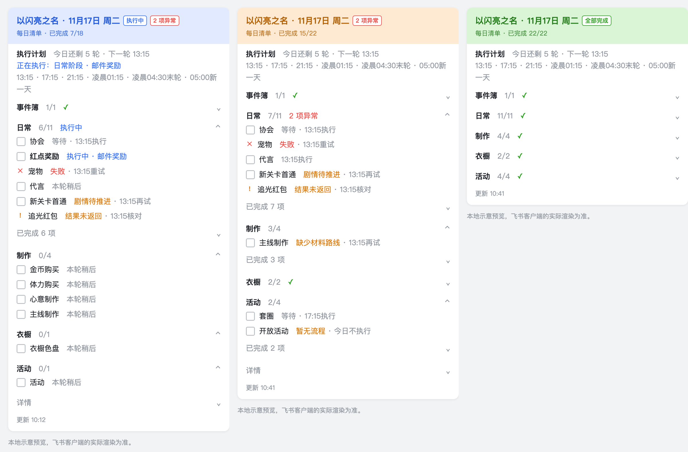

# autocontrol 本地自动执行总控台

按计划调度各项目的自动化执行器，把每一轮的进度实时更新到**一张飞书 todolist 卡片**上，同时归档结果、记录运行指标，并为新接入的脚本提供统一的协议、准入检查和指标阈值。

由 `yslzm/tools` 下的总控台（`daily_board`、`run_scheduled` 等）重构而来，Review 结论见 [docs/REVIEW.md](docs/REVIEW.md)；接入新脚本请看 [docs/接入规范.md](docs/接入规范.md)。

## 能力

- **调度**：固定时刻 + 执行器上报的动态时刻（计时到期、窗口开放）；服务日切换时只读发现新计划；启动时补跑一轮；失败指数退避。cron 每 5 分钟只负责看护进程。
- **执行**：每轮按阶段顺序运行执行器子进程；单阶段失败不跳过、不重放后续阶段；探测账号锁，被占用时让路；超时终止。
- **卡片**：每个项目每个服务日一张卡片，先发布固定计划再启动执行器，执行中持续更新同一张卡片；通知故障不阻断业务，恢复后补发最新状态。
- **归档与指标**：每个阶段一份固定字段结果 JSON；`metrics.sqlite3` 记录阶段、轮次、任务日终状态；`metrics` 命令按阈值给出健康结论。
- **接入**：执行器协议 v1 + 声明式清单 `autocontrol.json` + `check` 准入检查 + 单文件 Python SDK + JSON Schema。

展示状态永远不授权、也不跳过任何业务动作：执行器每次都重新读取实时状态。

## 卡片



- **执行计划**两行常显在顶部：今日还剩几轮、下一轮几点、全部剩余轮次（服务器计时触发的标明来源，最后一轮标「末轮」），执行中多一行「正在执行：某阶段 · 某任务」。
- 按阶段分组（事件簿 → 日常 → 制作 → 衣橱 → 活动），每组只列出**未完成**的任务，已完成的折叠在组内「已完成 N 项」里，点击展开；整组完成时整组折叠并打 ✓。
- **每个未完成任务一行**：「标题　状态 · 下次执行」，如「普通色盘　材料不足 · 15:00再试」「宠物　失败 · 13:15重试」（红色 ✗）「代言　本轮稍后」；今日已做完（如画中蓬莱今日已成长）的项目直接折叠进「已完成」；长原因收进底部折叠的「详情」。
- 页头：`以闪亮之名 · 11月17日 周二`，副标题 `每日清单 · 已完成 x/y`，状态标签与颜色（执行中蓝、全部完成绿、有异常橙、等待浅蓝），会话列表摘要同步显示进度；今日不适用的任务隐藏，子步骤缺少状态的观察收进底部「详情」。

本地预览（不联网）：

```bash
python3 run.py preview --demo running --html /tmp/card.html
```

## 目录

```
autocontrol/
  schedule.py      服务日与唤醒时刻
  locks.py         flock 锁（与执行器账号锁兼容）
  worker.py        子进程 + 进度管道
  storage.py       私有结果归档（原子写入）
  protocol.py      执行器协议 v1：常量与严格校验
  runner.py        一轮：发布计划 → 逐阶段执行 → 收尾
  service.py       常驻调度
  admission.py     准入检查
  metrics.py       运行指标与阈值
  schemas.py       协议 JSON Schema 生成
  board/           目录、投影、卡片渲染、HTML 预览
  lark/            飞书客户端、卡片绑定存储、发布器
  projects/        base（项目接口）、manifest（协议接入）、yslzm（适配器接入）
sdk/python/autocontrol_worker.py   脚本侧 SDK（复制即用）
examples/demo_worker/              协议接入示例
docs/                              接入规范、Review、JSON Schema
tests/                             单元与端到端测试
```

## 使用（yslzm）

默认使用 `~/Documents/workspace/yslzm` 作为执行器目录、`~/.config/yslzm` 作为私有目录（与原总控台相同：锁、结果目录、`lark_app.json`、`daily_board.sqlite3` 都沿用，当天已有的卡片会继续更新而不是新发一张）。

```bash
# 只读发现当日计划，并发布／更新当天卡片
PYTHONDONTWRITEBYTECODE=1 python3 -B run.py once --observe-only
# 执行一整轮
PYTHONDONTWRITEBYTECODE=1 python3 -B run.py once
# 只执行一个阶段
PYTHONDONTWRITEBYTECODE=1 python3 -B run.py once --phase cardbook
# 运行指标
python3 run.py metrics
# 查机器人所在群的 chat_id
python3 run.py chats
```

`--workdir`、`--private`、`--python` 可覆盖默认位置与解释器。

**共享登录（一整轮一个进程）**：在私有目录写 `autocontrol.json`（权限 0600），内容 `{"shared_session": true}`，之后每轮只启动一次 `main.py run --phases …`。阶段之间会沿用仍然有效的登录，活动阶段按注册表的要求重新登录。卡片和指标仍然逐阶段更新，指标的 `sessions` 列记录每个阶段新开的登录数。共享进程中途退出时，正在跑的阶段如实记为失败或超时，不会重跑；还没开始的阶段按原方式逐个运行。删掉这个文件，或把值改为 `false`，下一轮起恢复逐阶段运行，不需要重启。

**固定时段的阶段**：`projects/yslzm/catalog.py` 的 `SCHEDULE.slots` 让某个阶段只在自己的时刻运行。事件簿是 06:00、14:00、22:00：06:00 跟全量轮一起跑，14:00 和 22:00 单独跑；其他唤醒不带它，除非它当前的时段还没有一次成功执行，这时在下一次唤醒补跑。卡片上这一行显示「已成功时段数/时段数 · 下次执行」，全部时段成功才算今日完成。时段必须和 yslzm 模块注册表的 `schedule` 一致，准入检查 Y7 会核对。

**服务器报告的唤醒**：`SCHEDULE.dynamic_phases` 决定这类唤醒只跑哪些阶段。yslzm 为 `('activities',)`，即活动开放时刻只跑活动阶段；05:00 换日前后 10 分钟内的时刻一律不唤醒。yslzm 的全量轮现为 06:00、13:15、21:15、04:30。

**重启服务**：只能在两轮之间（`round.lock` 没有被占用）操作，并且要带 `--observe-first`。不带这个参数的 `serve` 启动时会立刻补跑一整轮。

**适配器同步**：`projects/yslzm/summary.py` 与 `diagnostics.py` 是 `yslzm/tools/run_scheduled.py`、`result_diagnostics.py` 的移植（仅格式化，逻辑逐行一致，`tests/yslzm/test_phases.py` 为原测试移植）。yslzm 执行器的结果格式变化时需同步这两份文件。长期建议按[接入规范](docs/接入规范.md)让 yslzm 的 `main.py` 直接输出协议 v1，届时可删除这层副本。

### 从 `yslzm/tools/local_daily.py` 切换

1. 跑测试：`python3 -m pytest`。
2. 预览卡片：`python3 run.py preview --demo finished --html /tmp/card.html`。
3. 用真实配置只读试运行一次（会登录游戏读取状态并更新飞书卡片）：`python3 -B run.py once --observe-only`。
4. 安装看护（替换 crontab 中 yslzm 的旧条目，其他条目保持不变；旧的 `~/.config/yslzm/run_scheduled.py` 入口改为转入新控制台）：`python3 -B run.py install --no-start`。
5. 停掉旧的常驻进程：`pkill -f tools/local_daily.py`。新旧服务共用 `coordinator.lock`，旧进程在时新服务不会启动，不会出现双开；下一次 cron 看护会拉起新服务。

## 接入新的自动化脚本

```bash
# 1. 按 docs/接入规范.md 写 autocontrol.json，并按协议改造脚本（Python 可复制 sdk/python/autocontrol_worker.py）
# 2. 准入检查（只读运行脚本并逐项打分，通过后才允许调度）
python3 run.py check --manifest path/to/autocontrol.json --repeat 2
# 3. 试运行与上线
python3 run.py once --manifest path/to/autocontrol.json --observe-only
python3 run.py install --manifest path/to/autocontrol.json
```

示例：`python3 run.py check --manifest examples/demo_worker/autocontrol.json --private /tmp/demo-private`。

yslzm 这类适配器项目用 `python3 run.py check --project yslzm` 做准入（`--static` 只比对执行器源码，不登录游戏）：Y1–Y6 静态比对执行器源码与卡片目录（任务 ID、状态映射、原因码、单位、各阶段任务表、超时上限），L1–L4 做一次只读实跑。适配器属于总控台内部，接入规范只面向协议脚本的作者。

## 测试

```bash
python3 -m pytest
```

包含：从 yslzm 移植的结果摘要测试（证明迁移后行为一致）、投影、卡片、发布器（幂等与恢复）、调度、子进程、安装器、协议校验、清单项目、准入检查、指标、SDK 与 JSON Schema 一致性，以及用假执行器跑真实子进程协议的端到端测试。
